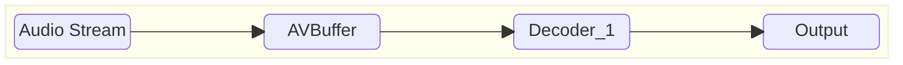
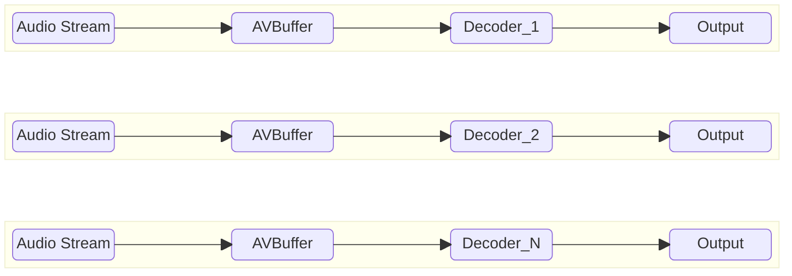

# Audio Decoder High Level Test Specification Document

## Table of Contents

- [Acronyms, Terms and Abbreviations](#acronyms-terms-and-abbreviations)
- [Introduction](#introduction)
- [Module Description](#module-description)
- [L2 Test Specification](#l2-test-specification)
- [L3 Test Specification](#l3-test-specification)

## Acronyms, Terms and Abbreviations

- `HAL`    - Hardware Abstraction Layer
- `API`    - Application Programming Interface
- `AIDL`   - Android Interface Definition Language
- `L2`     - Level 2 Testing
- `L3`     - Level 3 Testing
- `NA`     - Not Applicable
- `Caller` - Any user of the interface via the `APIs`
- `CB`     - Call-back function (suffix)
- `MS12`   - MultiStream 12
- `PCM`    - Pulse Code Modulation
- `AC3`    - Audio Codec 3
- `EAC3`   - Enhanced `AC3`
- `WMA`    - Windows Media Audio
- `AAC`    - Advanced Audio coding
- `DD`     - DOLBY Digital
- `DDPLUS` - DOLBY Digital Plus
- `RDK`    - Reference Design Kit
- `EOS`    - End of Stream
- `rms`    - Root mean Square
- `PTS`    - Presentation Time Stamp

## Introduction

This document provides an overview of the testing requirements for the Audio Decoder module. It outlines the scope of testing, objectives, testing levels and approaches, specific test requirements.

- Audio Decoder Interface Definitions - [Audio Decoder HAL](https://github.com/rdkcentral/rdk-halif-aidl/tree/v0.6/audiodecoder/current/com/rdk/hal/audiodecoder)

- Audio Decoder Overview - [Audio Decoder Overview](https://wiki.rdkcentral.com/display/RDKHAL/Audio+Decoder)

## Module Description

The Audio Decoder `HAL` service provides the interfaces for compressed audio to be passed to the vendor layer for decoding.  It may be passed secure buffers if it indicates support for secure audio processing.

The output of an audio decoder can take two routes:

1. **Non-tunnel mode** - Decoded `PCM` audio frames with metadata are sent back to the `RDK` media pipeline.
2. **Tunnel mode** - Audio is passed directly to the vendor layer mixer.

## Test Streams Specification

- List of audio test streams: [Audio TestStreams](audioDecoder_TestStreams.md)

- Each Test should refer [vts_l3_test_config.yaml](../../test_configuration/vts_l3_test_config.yaml) for the streams and information like `PTS`, frame sizes for the test.

## L2 Test Specification

|Test|Description|HAL APIs|
|----|-----------|--------|
|Set and Get Audio Properties|<ul><li>Read supported audio decoders using `IAudioDecoderManager` class</li><li>Loop through supported audio decoders</li><li>set read-write properties (`Property`) of decoder and verify using get function</li></ul>|<ul><li>IAudioDecoderManager - getAudioDecoderIds, getAudioDecoder</li><li>IAudioDecoder - open, getProperty, close </li><li>IAudioDecoderController - setProperty</li></ul>|
|Set and Get Audio Properties with multi instance of audio decoder|<ul><li>Read supported audio decoders using `IAudioDecoderManager` class</li><li>If platform supports multiple decoder, open all the instances of the decoders</li><li>set read-write properties (`Property`) of all decoders and verify using get function</li></ul>|<ul><li>IAudioDecoderManager - getAudioDecoderIds, getAudioDecoder</li><li>IAudioDecoder - open, getProperty, close </li><li>IAudioDecoderController - setProperty</li></ul>|
|States of Audio Decoder|<ul><li>Read supported audio decoders using `IAudioDecoderManager` class</li><li>Loop through supported audio decoders</li><li>Register event listeners using `registerEventListener`</li><li>Ensure state transitions (`open -> start -> flush -> stop -> close`) work as expected using `getState`. Validate event listener notifications using `onStateChanged`.</li></ul>|<ul><li>IAudioDecoderManager - getAudioDecoderIds, getAudioDecoder</li><li>IAudioDecoder - open, getState, registerEventListener, unregisterEventListener, close </li><li>IAudioDecoderController - start, stop, flush</li></ul>|
|States of Audio Decoder with multi instance|<ul><li>Read supported audio decoders using `IAudioDecoderManager` class</li><li>If platform supports multiple decoder, open all the instances of the decoders</li><li>Register event listeners using `registerEventListener`</li><li>Ensure state transitions of all decoder instances (`open -> start -> flush -> stop -> close`) work as expected using `getState`. Validate event listener notifications using `onStateChanged`.</li></ul>|<ul><li>IAudioDecoderManager - getAudioDecoderIds, getAudioDecoder</li><li>IAudioDecoder - open, getState, registerEventListener, unregisterEventListener, close </li><li>IAudioDecoderController - start, stop, flush</li></ul>|

## L3 Test Specification

### Prerequisites

Supplying audio frames to the decoder tests requires AVBuffer handles; therefore, the AVBuffer modules must be tested for L1, L2 and L3 prior to executing the AudioDecoder L3 tests

### Feature List

The test verifies all features in both sequential and concurrent decoding modes (if the platform supports multiple decoders)

#### Sequential Decoding

#### Concurrent Decoding

The following table outlines the core features validated in the L3 test phase

|#|Testing Feature|Description|
|-|---------------|-----------|
|1|Tunnel/Non-Tunnel|Executes the decoder in tunnel mode. Based on stream format, the decoder chooses between tunnel and non-tunnel operation. In tunnel mode, the test validates only metrics and metadata. In non-tunnel mode, it also validates decoded buffers by comparing their RMS difference against reference data.|
|2|Secure|Initializes the decoder in secure mode, ensuring all buffer operations occur in secure memory|
|3|Error Streams|Verifies decoder behaviour with error streams. Ensures appropriate events are raised and frame metadata is updated accurately|
|4|Trim|Sends trim parameters to the decoder and checks whether the output buffer is correctly trimmed|
|5|Discontinuity|Simulate a discontinuity in the input stream and verify that the decoder correctly decodes subsequent frames and updates the corresponding metadata fields.|
|6|EOS|Test the decoder's handling of an `eos` (end-of-stream) signal. The decoder should correctly decode all frames up to `eos` and update relevant metadata fields. It must ignore any buffers received after `eos` and resume normal decoding when restarted.|
|7|Flush without reset|Test the decoder's flush functionality. The decoder should discard any buffers already queued and resume normal decoding of subsequent frames|
|8|Flush with reset|Test the decoder’s flush functionality combined with reset. The decoder should discard all queued buffers and transition to the READY state. After restarting, the decoder should properly process incoming frames|
|9|Concurrent decoding|If platform supports multiple decoders, test executes multiple decoders simultaneously, validating decoded outputs and their respective metrics.|

### Test Cases

The table below summarizes the L3 test cases executed using various audio stream formats and configurations:

|#|Test|Tunnel|Secure|Error streams|Trim|Discontinuity|EOS|Flush|Flush+Rest|Concurrency|
|-|----|------|------|-------------|----|-------------|---|-----|----------|-----------|
|1|Decode_Sequential_NonTunnel_NonSecure|✘|✘|✘|✘|✘|✘|✘|✘|✘|
|2|Decode_Sequential_NonTunnel_NonSecure_Error|✘|✘|✔|✘|✘|✘|✘|✘|✘|
|3|Decode_Sequential_NonTunnel_NonSecure_Trim|✘|✘|✘|✔|✘|✘|✘|✘|✘|
|4|Decode_Sequential_NonTunnel_NonSecure_Discontinuity|✘|✘|✘|✘|✔|✘|✘|✘|✘|
|5|Decode_Sequential_NonTunnel_NonSecure_EOS|✘|✘|✘|✘|✘|✔|✘|✘|✘|
|6|Decode_Sequential_NonTunnel_NonSecure_Flush|✘|✘|✘|✘|✘|✘|✔|✘|✘|
|7|Decode_Sequential_NonTunnel_NonSecure_FlushReset|✘|✘|✘|✘|✘|✘|✘|✔|✘|
|9|Decode_Sequential_NonTunnel_Secure|✘|✔|✘|✘|✘|✘|✘|✘|✘|
|10|Decode_Sequential_NonTunnel_Secure_Error|✘|✔|✔|✘|✘|✘|✘|✘|✘|
|11|Decode_Sequential_NonTunnel_Secure_Trim|✘|✔|✘|✔|✘|✘|✘|✘|✘|
|12|Decode_Sequential_NonTunnel_Secure_Discontinuity|✘|✔|✘|✘|✔|✘|✘|✘|✘|
|13|Decode_Sequential_NonTunnel_Secure_EOS|✘|✔|✘|✘|✘|✔|✘|✘|✘|
|14|Decode_Sequential_NonTunnel_Secure_Flush|✘|✔|✘|✘|✘|✘|✔|✘|✘|
|15|Decode_Sequential_NonTunnel_Secure_FlushReset|✘|✔|✘|✘|✘|✘|✘|✔|✘|
|16|Decode_Sequential_Tunnel_NonSecure|✔|✘|✘|✘|✘|✘|✘|✘|✘|
|17|Decode_Sequential_Tunnel_NonSecure_Error|✔|✘|✔|✘|✘|✘|✘|✘|✘|
|18|Decode_Sequential_Tunnel_NonSecure_Trim|✔|✘|✘|✔|✘|✘|✘|✘|✘|
|19|Decode_Sequential_Tunnel_NonSecure_Discontinuity|✔|✘|✘|✘|✔|✘|✘|✘|✘|
|20|Decode_Sequential_Tunnel_NonSecure_EOS|✔|✘|✘|✘|✘|✔|✘|✘|✘|
|21|Decode_Sequential_Tunnel_NonSecure_Flush|✔|✘|✘|✘|✘|✘|✔|✘|✘|
|22|Decode_Sequential_Tunnel_NonSecure_FlushReset|✔|✘|✘|✘|✘|✘|✘|✔|✘|
|23|Decode_Sequential_Tunnel_Secure|✔|✔|✘|✘|✘|✘|✘|✘|✘|
|24|Decode_Sequential_Tunnel_Secure_Error|✔|✔|✔|✘|✘|✘|✘|✘|✘|
|25|Decode_Sequential_Tunnel_Secure_Trim|✔|✔|✘|✔|✘|✘|✘|✘|✘|
|26|Decode_Sequential_Tunnel_Secure_Discontinuity|✔|✔|✘|✘|✔|✘|✘|✘|✘|
|27|Decode_Sequential_Tunnel_Secure_EOS|✔|✔|✘|✘|✘|✔|✘|✘|✘|
|28|Decode_Sequential_Tunnel_Secure_Flush|✔|✔|✘|✘|✘|✘|✔|✘|✘|
|29|Decode_Sequential_Tunnel_Secure_FlushReset|✔|✔|✘|✘|✘|✘|✘|✔|✘|
|30|Decode_Concurrent_NonTunnel_NonSecure|✘|✘|✘|✘|✘|✘|✘|✘|✔|
|31|Decode_Concurrent_NonTunnel_NonSecure_Error|✘|✘|✔|✘|✘|✘|✘|✘|✔|
|32|Decode_Concurrent_NonTunnel_NonSecure_Trim|✘|✘|✘|✔|✘|✘|✘|✘|✔|
|33|Decode_Concurrent_NonTunnel_NonSecure_Discontinuity|✘|✘|✘|✘|✔|✘|✘|✘|✔|
|34|Decode_Concurrent_NonTunnel_NonSecure_EOS|✘|✘|✘|✘|✘|✔|✘|✘|✔|
|35|Decode_Concurrent_NonTunnel_NonSecure_Flush|✘|✘|✘|✘|✘|✘|✔|✘|✔|
|36|Decode_Concurrent_NonTunnel_NonSecure_FlushReset|✘|✘|✘|✘|✘|✘|✘|✔|✔|
|37|Decode_Concurrent_NonTunnel_Secure|✘|✔|✘|✘|✘|✘|✘|✘|✔|
|38|Decode_Concurrent_NonTunnel_Secure_Error|✘|✔|✔|✘|✘|✘|✘|✘|✔|
|39|Decode_Concurrent_NonTunnel_Secure_Trim|✘|✔|✘|✔|✘|✘|✘|✘|✔|
|40|Decode_Concurrent_NonTunnel_Secure_Discontinuity|✘|✔|✘|✘|✔|✘|✘|✘|✔|
|41|Decode_Concurrent_NonTunnel_Secure_EOS|✘|✔|✘|✘|✘|✔|✘|✘|✔|
|42|Decode_Concurrent_NonTunnel_Secure_Flush|✘|✔|✘|✘|✘|✘|✔|✘|✔|
|43|Decode_Concurrent_NonTunnel_Secure_FlushReset|✘|✔|✘|✘|✘|✘|✘|✔|✔|
|44|Decode_Concurrent_Tunnel_NonSecure|✔|✘|✘|✘|✘|✘|✘|✘|✔|
|45|Decode_Concurrent_Tunnel_NonSecure_Error|✔|✘|✔|✘|✘|✘|✘|✘|✔|
|46|Decode_Concurrent_Tunnel_NonSecure_Trim|✔|✘|✘|✔|✘|✘|✘|✘|✔|
|47|Decode_Concurrent_Tunnel_NonSecure_Discontinuity|✔|✘|✘|✘|✔|✘|✘|✘|✔|
|48|Decode_Concurrent_Tunnel_NonSecure_EOS|✔|✘|✘|✘|✘|✔|✘|✘|✔|
|49|Decode_Concurrent_Tunnel_NonSecure_Flush|✔|✘|✘|✘|✘|✘|✔|✘|✔|
|50|Decode_Concurrent_Tunnel_NonSecure_FlushReset|✔|✘|✘|✘|✘|✘|✘|✔|✔|
|51|Decode_Concurrent_Tunnel_Secure|✔|✔|✘|✘|✘|✘|✘|✘|✔|
|52|Decode_Concurrent_Tunnel_Secure_Error|✔|✔|✔|✘|✘|✘|✘|✘|✔|
|53|Decode_Concurrent_Tunnel_Secure_Trim|✔|✔|✘|✔|✘|✘|✘|✘|✔|
|54|Decode_Concurrent_Tunnel_Secure_Discontinuity|✔|✔|✘|✘|✔|✘|✘|✘|✔|
|55|Decode_Concurrent_Tunnel_Secure_EOS|✔|✔|✘|✘|✘|✔|✘|✘|✔|
|56|Decode_Concurrent_Tunnel_Secure_Flush|✔|✔|✘|✘|✘|✘|✔|✘|✔|
|57|Decode_Concurrent_Tunnel_Secure_FlushReset|✔|✔|✘|✘|✘|✘|✘|✔|✔|

