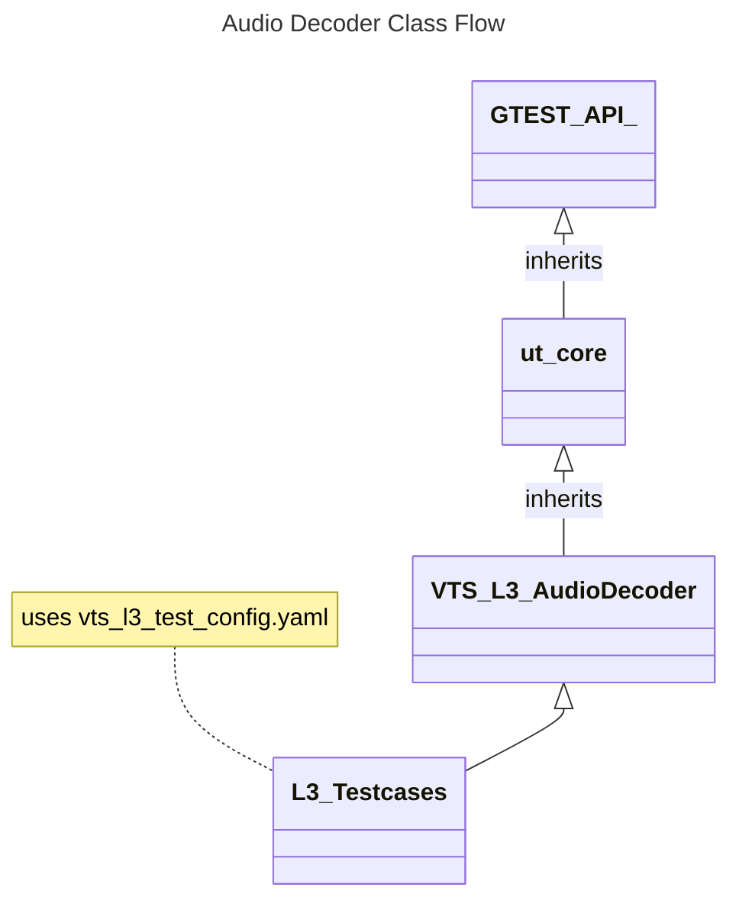
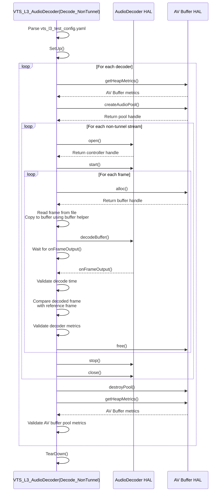

# AUDIO DECODER L3 Low Level Test Specification and Procedure Documentation

## Table of Contents

- [Overview](#overview)
- [Acronyms, Terms and Abbreviations](#acronyms-terms-and-abbreviations)
- [References](#references)
- [Test Configuration](#test-configuration)
- [Class Design](#class-design)
- [Common Validation Functions](#common-validation-functions)
- [L3 Tests](#l3-tests)


### Acronyms, Terms and Abbreviations

- `HAL` \- Hardware Abstraction Layer, may include some common components
- `UT`  \- Unit Test(s)
- `rms`  \- Root Mean Square
- `YAML` \- Yet Another Markup Language
- `PTS` \- Presentation Time Stamp
- `Hz` \- Hertz
- `AAC` \- Advanced Audio Coding
- `PCM` \- Pulse Code Modulation

## Overview

This document outlines the L3 test design for the Audio Decoder module.

## References

- High Level Test Specification - [audioDecoder_High-Level_TestSpecification.md](audioDecoder_High-Level_TestSpecification.md)
- Audio Decoder Interface Definitions - [Audio Decoder HAL](https://github.com/rdkcentral/rdk-halif-aidl/tree/v0.6/audiodecoder/current/com/rdk/hal/audiodecoder)
- Audio Decoder Overview - [Audio Decoder Overview](https://rdkcentral.github.io/rdk-halif-aidl/halif/audio_decoder/current/audio_decoder/)
- Audio test streams: [Audio TestStreams](audioDecoder_TestStreams.md)

## Test Configuration

The test configuration is defined in [vts_l3_test_config.yaml](../../test_configuration/vts_l3_test_config.yaml), , which specifies the streams, `PTS` values, frame sizes, and other key parameters required for L3 validation. This configuration includes references to supporting `YAML` files such as [vts_audio_aac_streams.yaml](../../test_configuration/vts_audio_aac_streams.yaml) files required by the test.

### Example Test Configuration File

```yaml
include_0: test_configuration/vts_audio_aac_streams.yaml
include_1: test_configuration/vts_audio_mp3_streams.yaml

IAudioDecoderManager:
  stream_download_path: "http://<>/streams"
  input_streams_path: "assets/streams/input"
  reference_streams_path: "assets/streams/reference/"
  L3:
    Decode_NonTunnel:
      Streams:
        - Name: tones_48k_2_256_aac
          PTS:
            - 0
            - 21333333
            - 42666666
            - 63999999
            - 85333332
            - 106666665
            - 127999998
            - 149333331
            - 170666664
            - 191999997
          trim:
            - 127999998 #Start in Nano seconds
            - 149333331 #End
          rms_diff_threshold: 0.5
          decode_time_threshold: 10000000 #Time in nano seconds
        - Name: tones_48k_1_256_aac
          PTS:
            - 0
            - 21333333
            - 42666666
            - 63999999
            - 85333332
            - 106666665
            - 127999998
            - 149333331
            - 170666664
            - 191999997
          trim:
            - 127999998 #Start in Nano seconds
            - 149333331 #End
          rms_diff_threshold: 0.5
          decode_time_threshold: 10000000 #Time in nano seconds
```

#### Key Parameters

- stream_download_path: URL path to download the audio test streams
- input_streams_path: Local path where input streams are stored
- reference_streams_path: Local path for reference PCM streams
- Name: Identifier for the stream, as defined in the stream configuration file
- PTS: Presentation Time Stamps (per frame) in nanoseconds
- trim: Start and end trim points in Nano seconds
- rms_diff_threshold: Maximum allowed `rms` difference for output validation
- decode_time_threshold: Time budget per frame for decoding, in nanoseconds

### Example Stream Configuration File

```yaml
AudioStreams:
  tones_48k_2_256_aac:
    input: tones_48k_2_256.aac
    reference: tones_48k_2_256_ref.pcm
    codec: AAC_LC
    sample_rate: 48000
    channels: 2
    format: S16LE
    num_of_frames: 10
    frame_size:
      - 288
      - 312
      - 372
      - 370
      - 344
      - 362
      - 360
      - 356
      - 355
      - 334
  tones_48k_1_256_aac:
    input: tones_48k_1_256.aac
    reference: tones_48k_1_256_ref.pcm
    codec: AAC_LC # refer enum Codec for more Codec details
    sample_rate: 48000
    channels: 1
    format: S16LE # refer enum PCMFormat for more format details
    num_of_frames: 10
    frame_size:
      - 203
      - 176
      - 223
      - 190
      - 204
      - 200
      - 194
      - 207
      - 185
      - 201
```

#### Key Parameters

- input: Stream name
- reference: Reference stream name
- codec: audio codec information, Refer `Codec` enum
- sample_rate: Sample rate in `Hz`
- channels: Number of audio channels
- format: `pcm` format of the reference stream. Refer `PCMFormat` enum
- num_of_frames: Total number of frames in the stream
- frame_size: Byte size for each frame, listed in order

## Class Design

The L3 audio decoder tests are implemented using the C++ variant of `ut-core`. For more information on the framework, refer to [ut-core](https://github.com/rdkcentral/ut-core/blob/4.7.0/README.md)

The following class diagram shows the inheritance structure and configuration dependencies for the test suite:



The `VTS_L3_AudioDecoder` class overrides the `SetUp()` and `TearDown()` methods from the `GTEST_API_` base class to handle test initialization and clean-up tasks common across test cases.

|#|VTS_L3_AudioDecoder Functions|Arguments|Description|HAL API|
|-|-----------------------------|----------|-----------|---|
|1|Setup|None|Initializes the test by acquiring service handles, supported decoder IDs, decoder capabilities, and registering event listeners|`getAudioDecoderIds()`<br>`getAudioDecoder()`<br>`registerEventListener()`<br>`getCapabilities()`|
|2|TearDown|None|Cleans up by unregistering event listeners|`unregisterEventListener()`|
|3|decodeAudioStreams|IAudioDecoder::Id decoderId<br>sp<IAudioDecoder> decoderHandle<br>sp<AudioDecoderControllerListener> controlListener<br>sp<AudioDecoderEventListener> eventListener<br>bool secureDecode<br>std::vector<testConfiguration_t> streamDetails|decodes the audio streams frame by frame|`createAudioPool()`<br>`alloc()`<br>`free()`<br>`destroyPool()`<br>`open()`<br>`start()`<br>`decodeBuffer()`<br>`stop()`<br>`close()`|

## Common Validation Functions

### Validate Decoded Buffer

The decoded `PCM` output is validated by comparing its `rms` value against the reference stream. The comparison uses the `rms_diff_threshold` defined in the [vts_l3_test_config.yaml](../../test_configuration/vts_l3_test_config.yaml) configuration file.

### Validate Decoder Metrics

The following decoder metrics are validated before and after decoding to ensure accurate tracking:

- `METRIC_FRAMES_DECODED`
- `METRIC_DECODE_ERRORS`
- `METRIC_FRAMES_DROPPED`

These are retrieved using the `getProperty()` API. The test confirms that the metrics increment correctly during the decoding process.

### Validate Decode Time

The time taken to decode each frame is calculated as the difference between `decodeBuffer()` and the corresponding `onFrameOutput()` event. The result is validated against the `decode_time_threshold` specified in the configuration [vts_l3_test_config.yaml](../../test_configuration/vts_l3_test_config.yaml)

### Validate AV Buffers

This check ensures that both the test suite and the decoder HAL properly release allocated audio buffers. It compares memory usage at the beginning and end of each test using the `getHeapMetrics()` API to confirm no memory leaks or unreleased buffers remain.

## L3 Tests

### Decode_NonTunnel

The following sequence diagram illustrates the flow of the `Decode_NonTunnel` test scenario, executed by the `VTS_L3_AudioDecoder` class:



