# AUDIO DECODER L3 Low Level Test Specification and Procedure Documentation

## Table of Contents

- [Overview](#overview)
- [Acronyms, Terms and Abbreviations](#acronyms-terms-and-abbreviations)
- [References](#references)
- [Test Configuration](#test-configuration)
- [Class Design](#class-design)
- [Common Validation Functions](#common-validation-functions)
- [L3 Tests](#l3-tests)


## Acronyms, Terms and Abbreviations

- `HAL` \- Hardware Abstraction Layer, may include some common components
- `UT`  \- Unit Test(s)
- `rms`  \- Root Mean Square
- `YAML` \- Yet Another Markup Language
- `PTS` \- Presentation Time Stamp
- `Hz` \- Hertz
- `AAC` \- Advanced Audio Coding
- `PCM` \- Pulse Code Modulation
- `EOS` \- End of Stream

## Overview

This document outlines the L3 test design for the Audio Decoder module.

## References

- High Level Test Specification - [audioDecoder_High-Level_TestSpecification.md](audioDecoder_High-Level_TestSpecification.md)
- Audio Decoder Interface Definitions - [Audio Decoder HAL](https://github.com/rdkcentral/rdk-halif-aidl/tree/v0.6/audiodecoder/current/com/rdk/hal/audiodecoder)
- Audio Decoder Overview - [Audio Decoder Overview](https://rdkcentral.github.io/rdk-halif-aidl/halif/audio_decoder/current/audio_decoder/)
- Audio test streams: [Audio TestStreams](audioDecoder_TestStreams.md)

## Test Configuration

The test configuration is defined in [vts_l3_test_config.yaml](../../test_configuration/vts_l3_test_config.yaml), , which specifies the streams, `PTS` values, frame sizes, and other key parameters required for L3 validation. This configuration includes references to supporting `YAML` files such as [vts_audio_aac_streams.yaml](../../test_configuration/vts_audio_aac_streams.yaml) files required by the test.

### Example Test Configuration File

```yaml
include_0: test_configuration/vts_audio_aac_streams.yaml
include_1: test_configuration/vts_audio_mp3_streams.yaml

IAudioDecoderManager:
  stream_download_path: "http://<>/streams"
  input_streams_path: "assets/streams/input"
  reference_streams_path: "assets/streams/reference/"
  L3:
    Decode_NonTunnel:
      delay_between_decode_calls: 5 #Time in milli seconds
      stop_start_pts: 106666665
      signal_discontinuity_pts: 149333331
      flush_pts: 170666664
      flush_reset_pts: 191999997
      eos_pts: 191999997
      Streams:
        - Name: tones_48k_2_256_aac
          PTS:
            - 0
            - 21333333
            - 42666666
            - 63999999
            - 85333332
            - 106666665
            - 127999998
            - 149333331
            - 170666664
            - 191999997
          trim:
            - 127999998 #Start in Nano seconds
            - 149333331 #End
          rms_diff_threshold: 0.5
          decode_time_threshold: 10000000 #Time in nano seconds
        - Name: tones_48k_1_256_aac
          PTS:
            - 0
            - 21333333
            - 42666666
            - 63999999
            - 85333332
            - 106666665
            - 127999998
            - 149333331
            - 170666664
            - 191999997
          trim:
            - 127999998 #Start in Nano seconds
            - 149333331 #End
          rms_diff_threshold: 0.5
          decode_time_threshold: 10000000 #Time in nano seconds
```

#### Key Parameters

- stream_download_path: URL path to download the audio test streams
- input_streams_path: Local path where input streams are stored
- reference_streams_path: Local path for reference PCM streams
- delay_between_decode_calls: insert delay in msec between each `decodeBuffer()` call
- stop_start_pts: `pts` value at which the decoder should be stopped and restarted during the test. -1 indicates that decoder should not be restarted
- signal_discontinuity_pts: `pts` value at which the test should signal discontinuity to the decoder. -1 indicates that no discontinuity signal should be sent
- flush_pts - `pts` value that determine when the test should flush the decoder. -1 indicates that test should not flush
- flush_reset_pts - `pts` value that determine when the test should flush with reset the decoder. -1 indicates that test should not flush
- eos_pts - `pts` value that determine when the test should sent `eos` signal to decoder. . -1 indicates that test should signal `eos`
- Name: Identifier for the stream, as defined in the stream configuration file
- PTS: Presentation Time Stamps (per frame) in nanoseconds
- trim: Start and end trim points in Nano seconds
- rms_diff_threshold: Maximum allowed `rms` difference for output validation
- decode_time_threshold: Time budget per frame for decoding, in nanoseconds

### Example Stream Configuration File

```yaml
AudioStreams:
  tones_48k_2_256_aac:
    input: tones_48k_2_256.aac
    reference: tones_48k_2_256_ref.pcm
    codec: AAC_LC
    sample_rate: 48000
    channels: 2
    format: S16LE
    num_of_frames: 10
    frame_size:
      - 288
      - 312
      - 372
      - 370
      - 344
      - 362
      - 360
      - 356
      - 355
      - 334
  tones_48k_1_256_aac:
    input: tones_48k_1_256.aac
    reference: tones_48k_1_256_ref.pcm
    codec: AAC_LC # refer enum Codec for more Codec details
    sample_rate: 48000
    channels: 1
    format: S16LE # refer enum PCMFormat for more format details
    num_of_frames: 10
    frame_size:
      - 203
      - 176
      - 223
      - 190
      - 204
      - 200
      - 194
      - 207
      - 185
      - 201
    #error_frames:
    #  - 0
    #  - 1
```

#### Key Parameters

- input: Stream name
- reference: Reference stream name
- codec: audio codec information, Refer `Codec` enum
- sample_rate: Sample rate in `Hz`
- channels: Number of audio channels
- format: `pcm` format of the reference stream. Refer `PCMFormat` enum
- num_of_frames: Total number of frames in the stream
- frame_size: Byte size for each frame, listed in order
- error_frames: List of invalid frame indices (starting from 0)
## Class Design

This test suite is designed using an object-oriented approach, leveraging the C++ variant of the `ut-core` testing framework. The following class structure and interaction model supports robust test orchestration, concurrent execution, and decoder validation.

### Primary Classes

|#|Class|Description|
|-|-----|-----------|
|1|VTS_L3_AudioDecoder|Test class which contains the test cases implementation|
|2|DecoderTest|Decoder test helper class|
|3|AudioDecoderControllerListener|AudioDecoder Controller listener class|
|4|AudioDecoderEventListener|AudioDecoder Event listener class|

### VTS_L3_AudioDecoder Class

The L3 audio decoder tests are implemented using the C++ variant of `ut-core`. For more information on the framework, refer to [ut-core](https://github.com/rdkcentral/ut-core/blob/4.7.0/README.md)

The following class diagram shows the inheritance structure and configuration dependencies for the test suite:

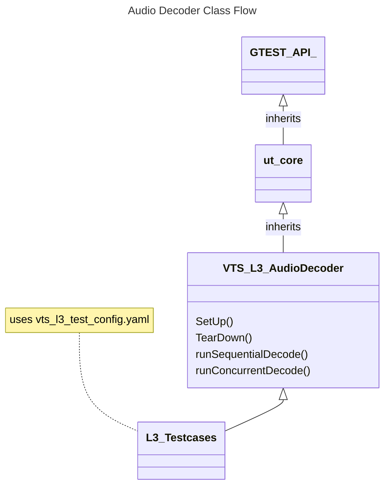
#### VTS_L3_AudioDecoder Class Functions

The class overrides `SetUp()` and `TearDown()` from `ut_core` to handle initialization and clean-up common to all test cases

|#|Function|Arguments|Description|HAL API|
|-|--------|---------|-----------|-------|
|1|Setup|None|Initializes the test by acquiring service handles, supported decoder IDs, decoder capabilities, and registering event listeners|`getAudioDecoderIds()`<br>`getAudioDecoder()`<br>`registerEventListener()`<br>`getCapabilities()`|
|2|TearDown|None|Cleans up by unregistering event listeners|`unregisterEventListener()`|
|3|runSequentialDecode|std::vector\<testConfiguration_t\>& streamDetails<br>bool secureDecode|Decodes streams using all decoders sequentially using `DecoderTest` Class|`getHeapMetrics()`|
|4|runConcurrentDecode|std::vector\<testConfiguration_t\>& streamDetails<br>bool secureDecode|Launches multiple threads to decode streams concurrently using `DecoderTest` Class|`getHeapMetrics()`|

#### Setup

The following sequence diagram illustrates the flow of the `Setup` function:

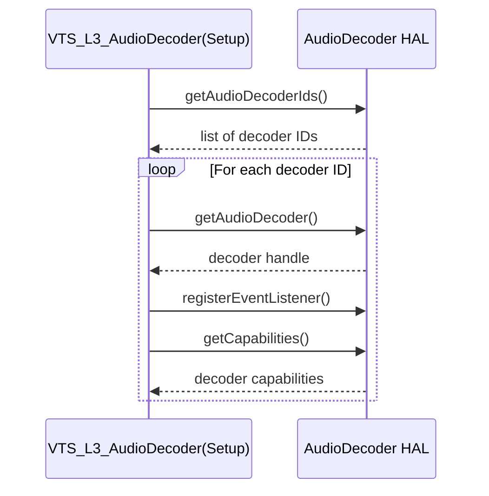
#### TearDown

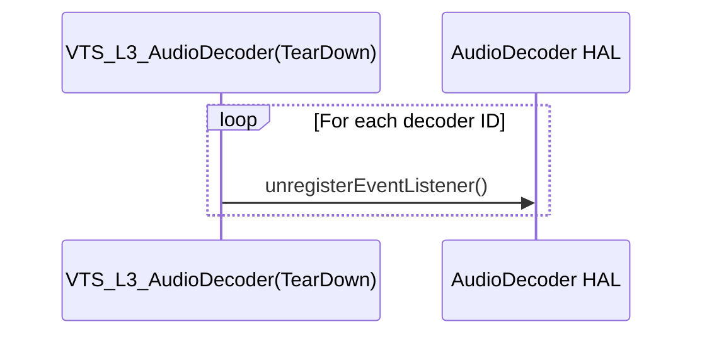

#### runSequentialDecode

The following sequence diagram illustrates the flow of the `runSequentialDecode` function:

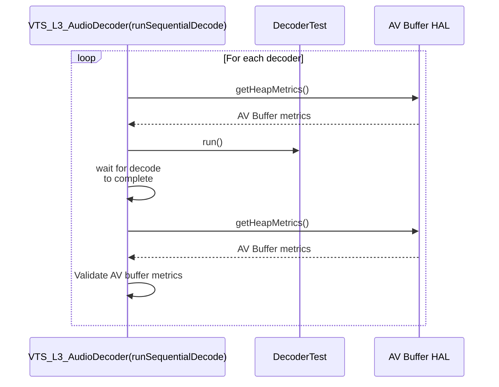

#### runConcurrentDecode

The following sequence diagram illustrates the flow of the `runConcurrentDecode` function:

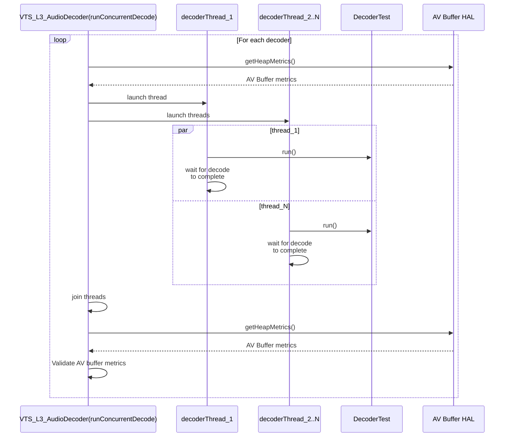

### DecoderTest Class

This class includes methods for testing individual streams and frames.

|#|Function|Arguments|Description|HAL API|
|-|--------|---------|-----------|-------|
|1|decoderThreadFunc||Decodes input streams frame by frame using a specific decoder instance|`createAudioPool()`<br>`alloc()`<br>`free()`<br>`destroyPool()`<br>`open()`<br>`start()`<br>`decodeBuffer()`<br>`stop()`<br>`close()`|
|2|consumerThreadFunc||Validates the decoded `pcm` buffer received from `onFrameOutput()` callback|`onFrameOutput()`|
|3|decodeAndConsumeAudioStreams|None|Decodes and consumes the audio frames sequentially|`createAudioPool()`<br>`alloc()`<br>`free()`<br>`destroyPool()`<br>`open()`<br>`start()`<br>`decodeBuffer()`<br>`stop()`<br>`close()`|
|4|run|bool concurrentDecodeConsume|Starts `decoderThreadFunc` and `consumerThreadFunc` threads or `decodeAndConsumeAudioStreams`|None|

#### decoderThreadFunc

The following sequence diagram illustrates the flow of the `decoderThreadFunc` function:

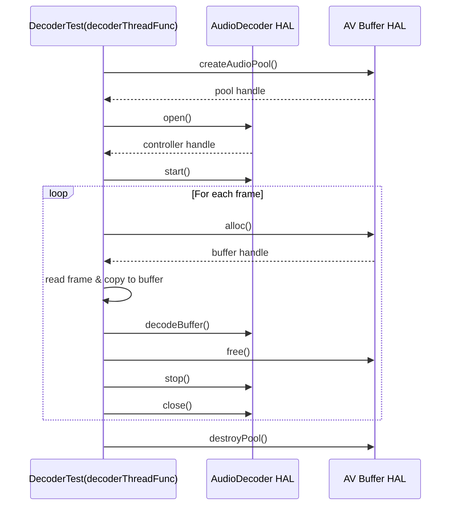

#### consumerThreadFunc

The following sequence diagram illustrates the flow of the `consumerThreadFunc` function:

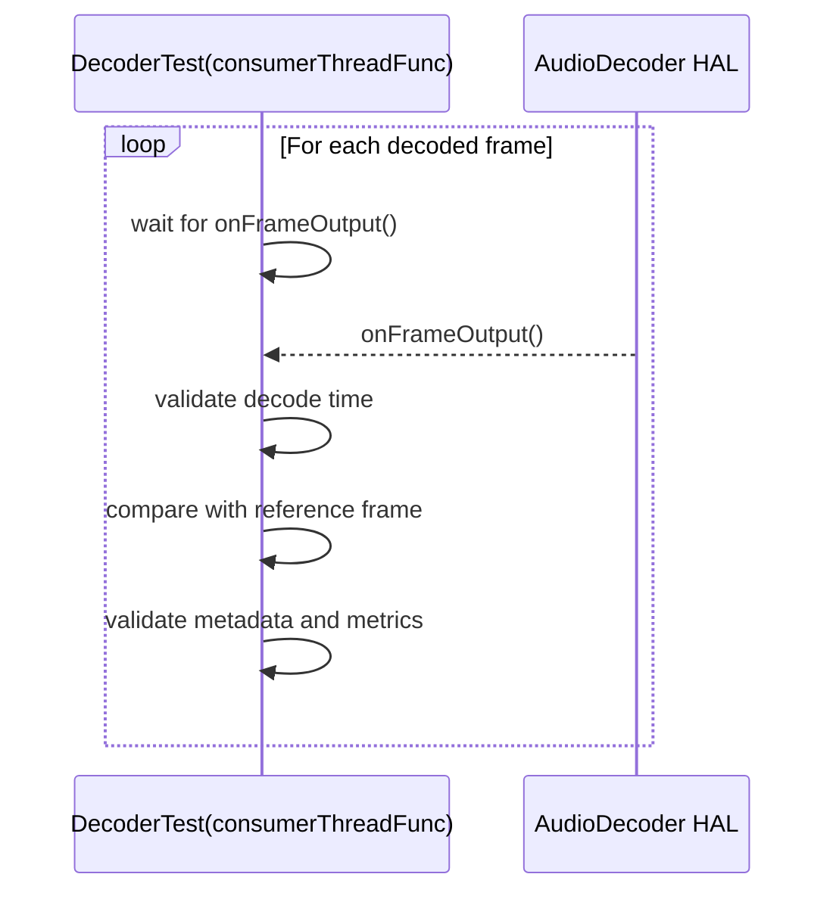
#### decodeAndConsumeAudioStreams

The following sequence diagram illustrates the flow of the `decodeAndConsumeAudioStreams` function:

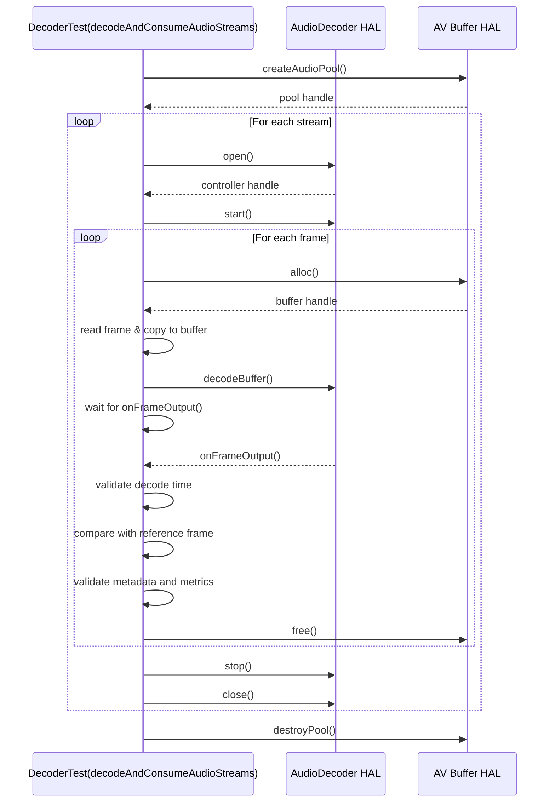

### AudioDecoderControllerListener Class

This class is responsible for handling decoded frame output callbacks from the AudioDecoder `HAL`. The class collects decoded audio buffers along with their metadata and timestamps for later validation by the test framework

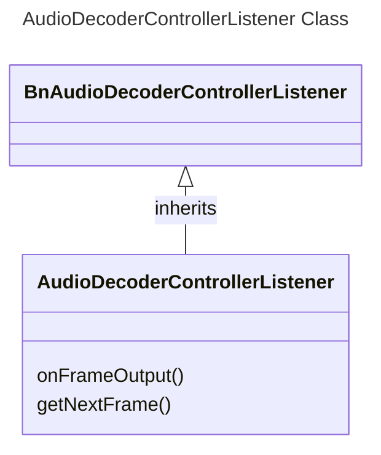

#### Structures

##### testConfiguration_t

AudioFrame_t encapsulates information about each decoded audio frame, including the raw PCM data, number of samples, associated metadata, and the timestamp at which the test received the buffer. This is useful for time-based validation and synchronization with the reference stream.

```cpp
typedef struct AudioFrame
{
    std::vector<uint8_t> data;  /* Decoded pcm data */
    size_t numSamples;          /* Number of samples in the buffer */
    bool isMetaAvailable;       /* is metadata received from callback */
    struct AudioMetatData metadata; /* metadata */
    std::chrono::steady_clock::time_point receiveTime; /* Time at which test received the buffer */
}AudioFrame_t;
```

#### AudioDecoderControllerListener Class Functions

|#|Function|Arguments|Description|
|-|--------|---------|-----------|
|1|onFrameOutput|int64_t nsPresentationTime<br>int64_t frameBufferHandle<br>const ::std::optional<FrameMetadata>& metadata|Override function from BnAudioDecoderControllerListener. Called by the `HAL` when a decoded frame is ready. It enqueues the decoded frame and metadata into an internal queue for test validation.|
|2|getNextFrame|AudioFrame_t &frameInfo|Pops the next available frame from the internal queue. Used by test logic to retrieve and validate decoded output|

### AudioDecoderEventListener Class

This class implements the BnAudioDecoderEventListener interface and is responsible for receiving and queuing events emitted by the AudioDecoder `HAL`. These events include decoding errors and state transitions, which are later validated by the test cases to ensure correct decoder behaviour.

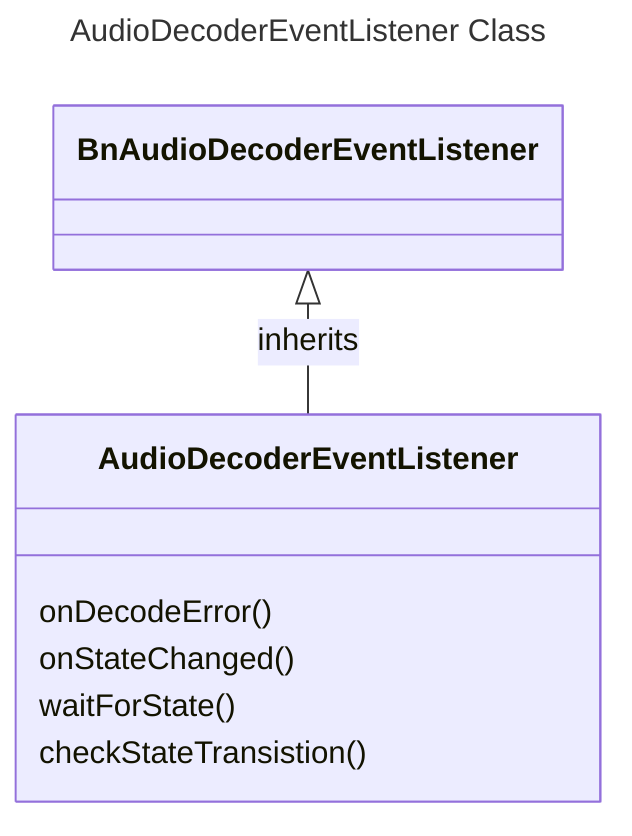

#### AudioDecoderEventListener Class Functions

|#|Function|Arguments|Description|
|-|--------|---------|-----------|
|1|onDecodeError|ErrorCode vendorErrorCode<br>int32_t errorCode|Callback invoked when the decoder reports an error. Captures the error information into an internal queue for further validation by the test case|
|2|onStateChanged|State oldState<br>State newState|Callback invoked when the decoder transitions between states. Logs the transition in a queue to allow the test case to verify correct state sequencing|
|3|waitForState|State desiredState<br>std::chrono::milliseconds timeout|Blocks execution until the decoder reaches the desired state or the timeout expires. Used to synchronize test flow with HAL state transitions|
|4|checkStateTransistion|State expOldState<br>State expNewState|Validates whether the expected transition from expOldState to expNewState has occurred by scanning the recorded state transition queue|

## Helper Functions

These utility functions are shared across all VTS test cases

### Structures

#### testConfiguration_t

This structure holds per-test configuration details parsed from the `YAML` file (`vts_l3_test_config.yaml`). It defines all the input stream characteristics, reference comparison parameters, and frame-level metadata needed for test execution. This structure drives test behaviour and validation logic.

```cpp
typedef struct testConfiguration {
    std::string input;          /* Path to input encoded stream file */
    std::string reference;      /* Path to reference PCM stream file */
    Codec codec;                /* Codec type (e.g., AAC, OPUS) */
    int32_t sampleRate;         /* Sample rate of the stream */
    int32_t numChannels;        /* Number of audio channels */
    PCMFormat format;           /* PCM format of the reference stream */
    int32_t numOfFrames;        /* Total number of frames expected in the stream */
    double rms_diff_threashold; /* Acceptable RMS difference threshold */
    int64_t trimStartNs;        /* Start trim position in nanoseconds */
    int64_t trimEndNs;          /* End trim position in nanoseconds */
    std::vector<std::tuple<int32_t, int64_t, bool>> frameDetails; /* Tuple of frameSize, PTS, isCorrupted */
} testConfiguration_t;
```
### Functions

|#|Helper Functions|Arguments|Description|
|-|----------------|---------|-----------|
|1|vts_audiodeccoder_parse_testconfig|void* pTestInstance: ut kvp instance<br>char *module: Module name<br>char *testGroup: Test group L1, L2, L3<br>char *testNameL: Test name<br>std::vector\<testConfiguration_t\>& configuration|Parses the `vts_l3_test_config.yaml` for the given module, test group, and test name. Populates a list of testConfiguration_t structures for use in the test|
|2|vts_audiodecoder_parseAudioDecoderHFP|None|Parses the HAL feature profile (HFP) file to determine supported capabilities of the AudioDecoder HAL under test|
|3|vts_computeRMSDiff|const void* ref_buf<br>const void* act_buf<br>size_t num_samples<br>PCMFormat format|Computes the Root Mean Square (RMS) difference between two PCM buffers (reference and actual). Used for validating decoded output accuracy.|

## Common Validation Functions

These functions provide standard mechanisms for validating the output and behaviour of the audio decoder under test

### Validate Decoded Buffer

The decoded `PCM` output is validated by comparing its `rms` value against the reference stream. The comparison uses the `rms_diff_threshold` defined in the [vts_l3_test_config.yaml](../../test_configuration/vts_l3_test_config.yaml) configuration file.

### Validate Decoder Metrics

The following decoder metrics are validated before and after decoding to ensure accurate tracking:

- `METRIC_FRAMES_DECODED`
- `METRIC_DECODE_ERRORS`
- `METRIC_FRAMES_DROPPED`

These are retrieved using the `getProperty()` API. The test confirms that the metrics increment correctly during the decoding process.

### Validate Decode Time

The time taken to decode each frame is calculated as the difference between `decodeBuffer()` and the corresponding `onFrameOutput()` event. The result is validated against the `decode_time_threshold` specified in the configuration [vts_l3_test_config.yaml](../../test_configuration/vts_l3_test_config.yaml)

### Validate AV Buffers

This check ensures that both the test suite and the decoder HAL properly release allocated audio buffers. It compares memory usage at the beginning and end of each test using the `getHeapMetrics()` API to confirm no memory leaks or unreleased buffers remain.

## L3 Tests

The L3 tests validate the functional correctness and performance of the AudioDecoder HAL by simulating real-world decoding workflows

### Decode_Sequential_NonTunnel_NonSecure

The following sequence diagram illustrates the flow of the `Decode_Sequential_NonTunnel_NonSecure` test scenario, executed by the `VTS_L3_AudioDecoder` class:

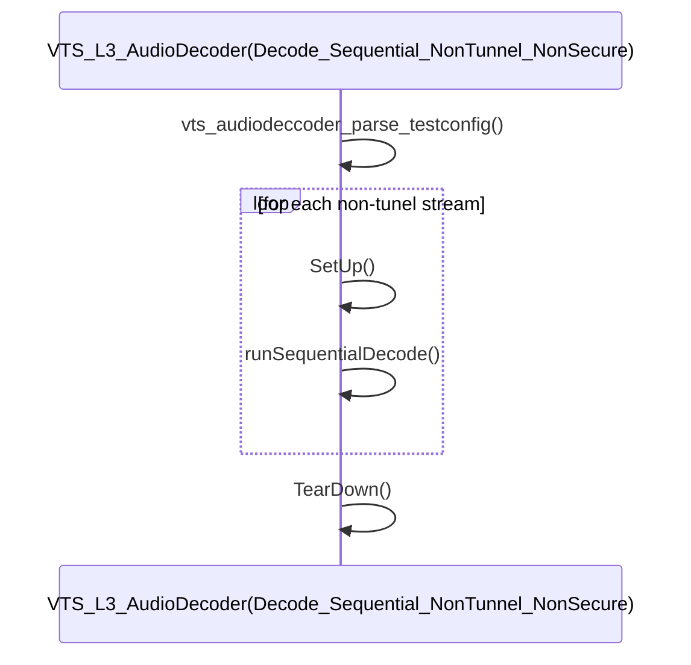

### Decode_Sequential_NonTunnel_NonSecure_Error

The following sequence diagram illustrates the flow of the `Decode_Sequential_NonTunnel_NonSecure_Error` test scenario, executed by the `VTS_L3_AudioDecoder` class:

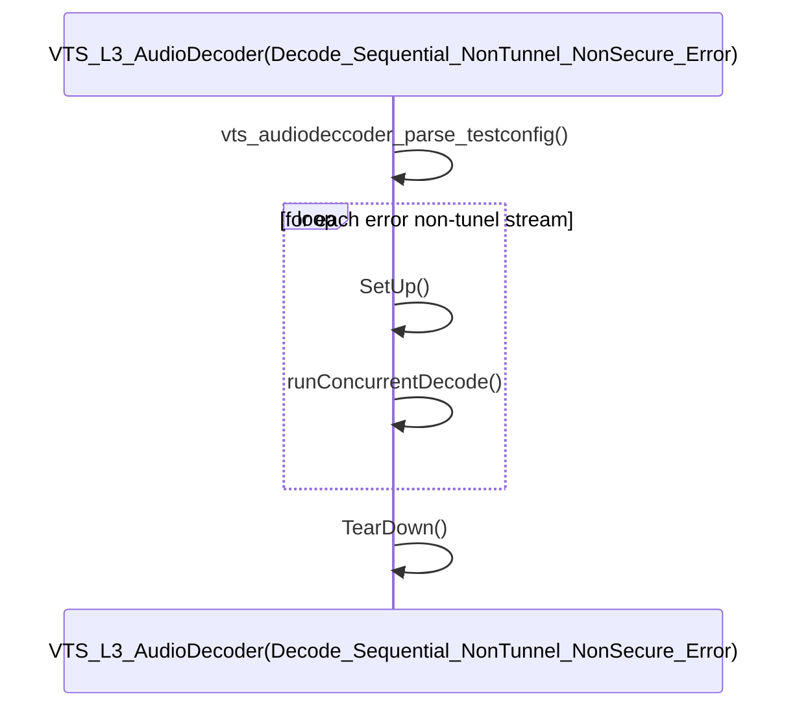

TBD: Add sections for all test cases