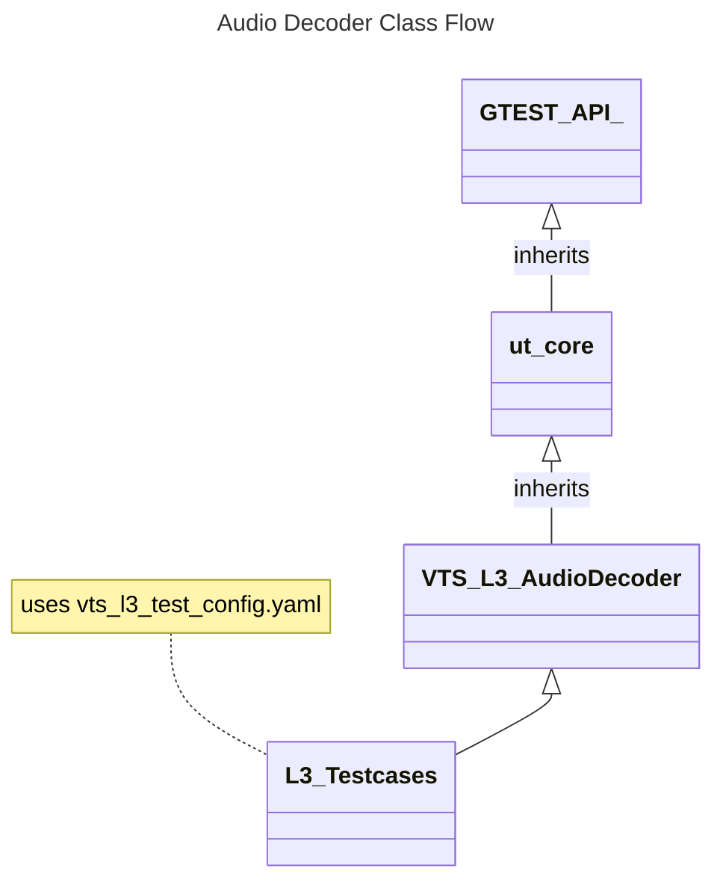
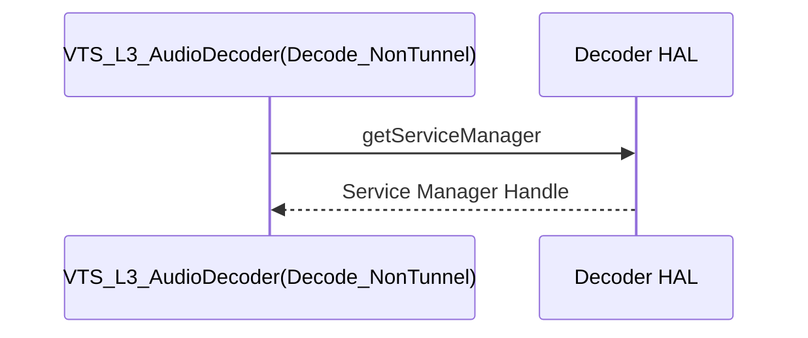

# AUDIO DECODER L3 Low Level Test Specification and Procedure Documentation

## Table of Contents

- [Overview](#overview)
- [Acronyms, Terms and Abbreviations](#acronyms-terms-and-abbreviations)
- [References](#references)
- [Test Configuration](#test-configuration)
- [L3 Tests](#l3-tests)


### Acronyms, Terms and Abbreviations

- `HAL` \- Hardware Abstraction Layer, may include some common components
- `UT`  \- Unit Test(s)
- `OEM`  \- Original Equipment Manufacture
- `SoC`  \- System on a Chip
- `rms`  \- Root Mean Square

## Overview

This document describes the L3 Test Specification for the Audio Decoder.

### References

- `High Level Test Specification` - [audioDecoder_High-Level_TestSpecification.md](audioDecoder_High-Level_TestSpecification.md)
- Audio Decoder Interface Definitions - [Audio Decoder HAL](https://github.com/rdkcentral/rdk-halif-aidl/tree/v0.6/audiodecoder/current/com/rdk/hal/audiodecoder)
- Audio Decoder Overview - [Audio Decoder Overview](https://rdkcentral.github.io/rdk-halif-aidl/halif/audio_decoder/current/audio_decoder/)
- Audio test streams: [Audio TestStreams](audioDecoder_TestStreams.md)

## Test Configuration

Test refer [vts_l3_test_config.yaml](../../test_configuration/vts_l3_test_config.yaml) for the streams and information like `PTS`, frame sizes for the test. This file includes the stream information `yaml` [vts_audio_aac_streams.yaml](../../test_configuration/vts_audio_aac_streams.yaml) files required by the test.

### Test Configuration File

```yaml
include_0: test_configuration/vts_audio_aac_streams.yaml
include_1: test_configuration/vts_audio_mp3_streams.yaml

IAudioDecoderManager:
  stream_download_path: "http://<>/streams"
  input_streams_path: "assets/streams/input"
  reference_streams_path: "assets/streams/reference/"
  L3:
    Decode_NonTunnel:
      Streams:
        - Name: tones_48k_2_256_aac
          PTS:
            - 0
            - 21333333
            - 42666666
            - 63999999
            - 85333332
            - 106666665
            - 127999998
            - 149333331
            - 170666664
            - 191999997
          trim:
            - 127999998 #Start in Nano seconds
            - 149333331 #End
          rms_diff_threshold: 0.5
```

- stream_download_path: URL path to download the audio test streams
- input_streams_path: Target path to copy the input audio streams
- reference_streams_path: Target path to copy the reference streams
- Name: Name of the stream referred from stream configuration files
- PTS: PTS values of each frame
- trim: trim start and end values in Nano seconds
- rms_diff_threshold: `rms` threshold value to validate the decoded output

### Stream Configuration File

```yaml
AudioStreams:
  tones_48k_2_256_aac:
    input: tones_48k_2_256.aac
    reference: tones_48k_2_256_ref.pcm
    codec: AAC_LC
    sample_rate: 48000
    channels: 2
    format: S16LE
    num_of_frames: 10
    frame_size:
      - 288
      - 312
      - 372
      - 370
      - 344
      - 362
      - 360
      - 356
      - 355
      - 334
```

- input: Stream name
- reference: Reference stream name
- codec: audio codec information, Refer `Codec` enum
- sample_rate: Sample rate of the stream in Hz
- channels: No. of Channels of the stream
- format: `pcm` format of the reference stream. Refer `PCMFormat` enum
- num_of_frames: No. of frames in the stream
- frame_size: Frame size of each frame in bytes

## Class Design

The class diagram below illustrates the flow of audio decoder test cases



VTS_L3_AudioDecoder class overrides `SetUp()` and `TearDown()` functions of `GTEST_API_` class. These function executes common pre and post requirements for all the tests

|#|Override Function|Description|API|
|-|-----------------|-----------|---|
|1|Setup|Gets the service manager handle, Gets the supported audio decoder id and handles, Gets the decoder handles, Registers event listener, Gets decoder capabilities|getAudioDecoderIds(), getAudioDecoder(), registerEventListener(), getCapabilities()|
|2|TearDown|Un-registers the events|unregisterEventListener()|

## L3 Tests

### Decode_NonTunnel



